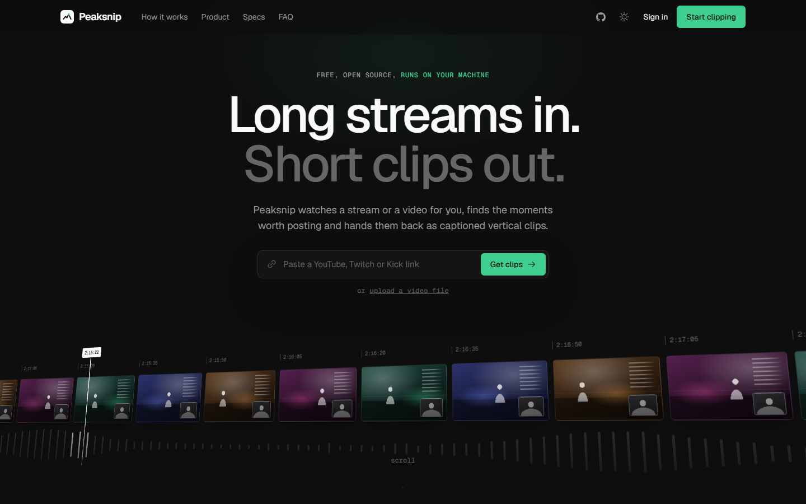
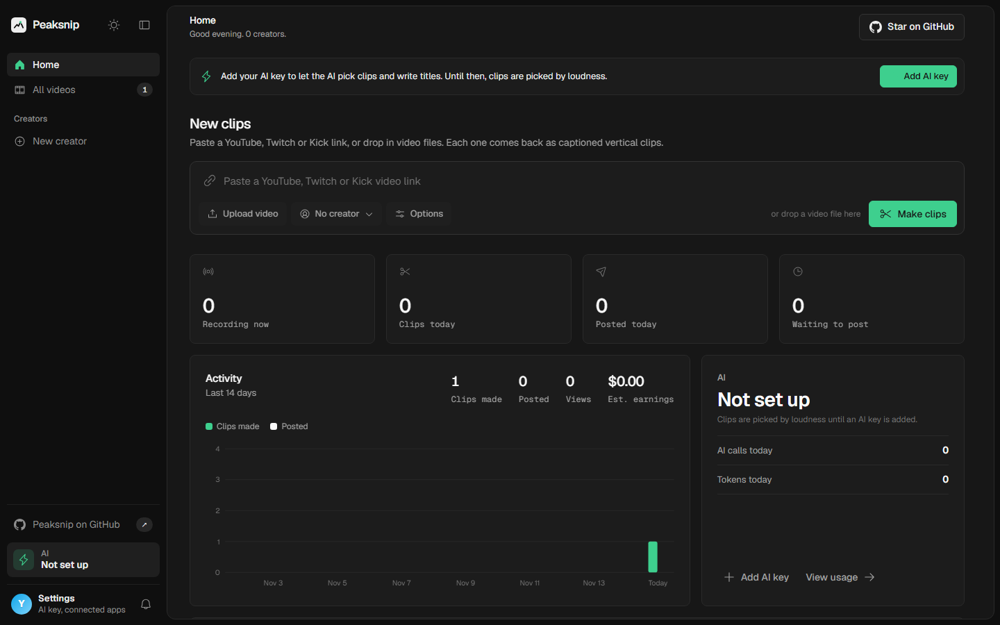
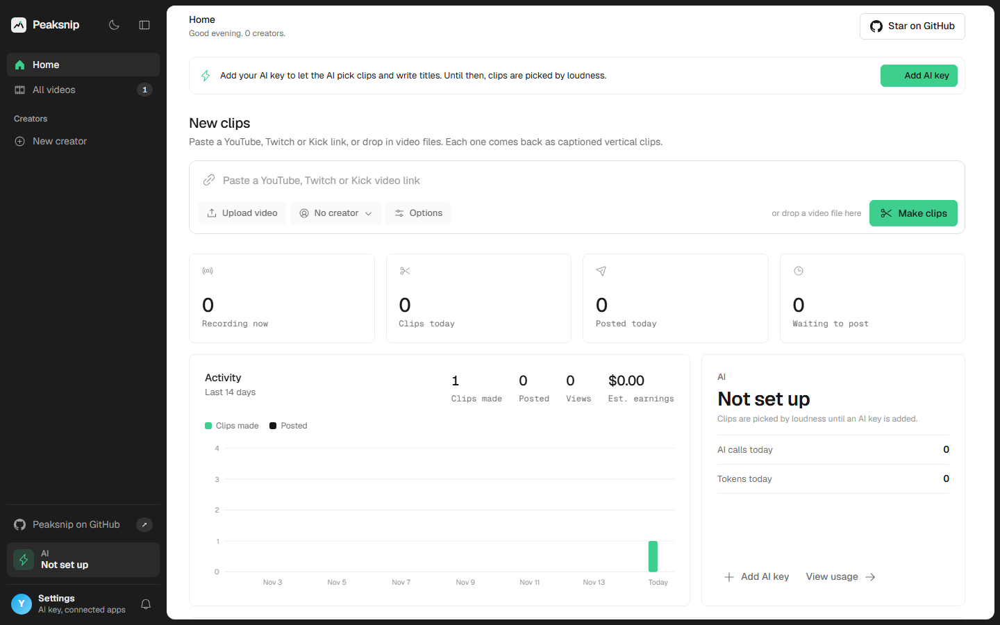
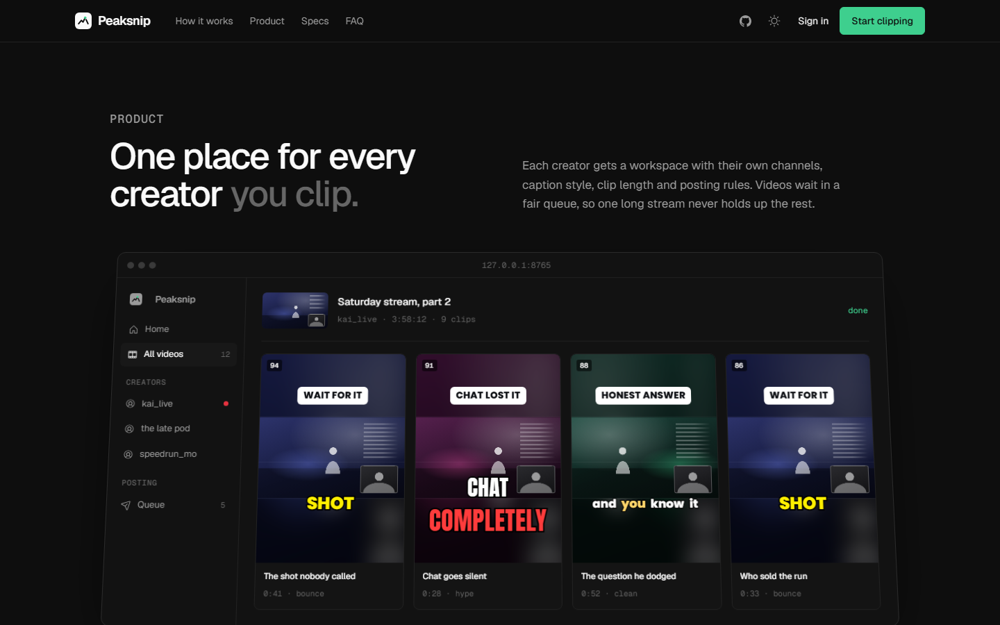
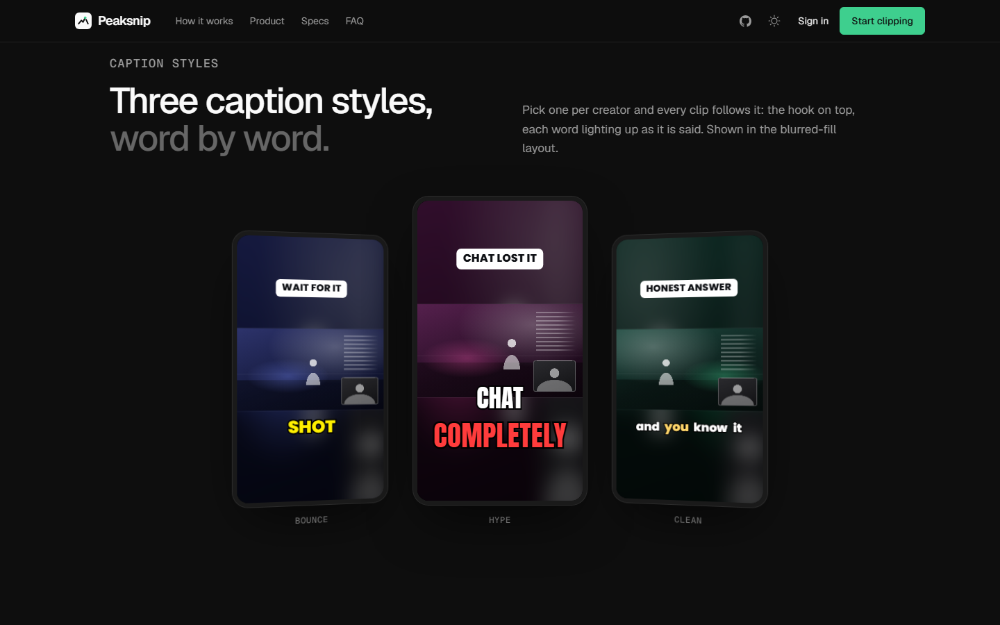
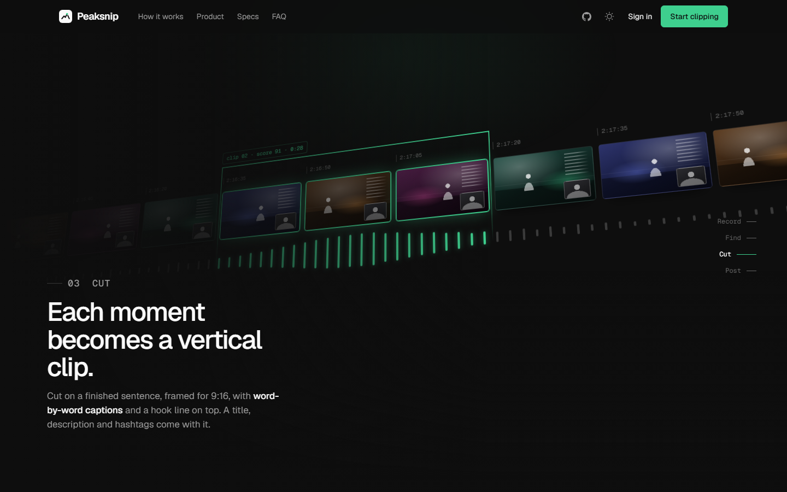

<p align="center">
  <picture>
    <source media="(prefers-color-scheme: dark)" srcset="web/brand/logo-light.svg">
    
  </picture>
</p>

<h3 align="center">Long streams in. Short clips out.</h3>

<p align="center">
  Turn long videos and live streams into captioned vertical clips, ready to post.<br>
  Free and open source: run it on your own computer or server, with your own AI key.
</p>

<p align="center">
  <a href="LICENSE"></a>
  
  
  <a href="DEPLOY.md"></a>
  
</p>

<p align="center">
  <a href="#quick-start"><b>Quick start</b></a> ·
  <a href="#choose-your-ai">Choose your AI</a> ·
  <a href="DEPLOY.md">Deploy</a> ·
  <a href="#how-it-is-built">How it is built</a>
</p>

<p align="center"></p>

Paste a YouTube, Twitch or Kick link (or upload a file) and Peaksnip finds the moments worth clipping, cuts them to
9:16, adds word-by-word captions and a hook, and can post them to your connected accounts. It can also record a
creator's live stream and clip the highlights while the stream is still running.

## A look inside

| | |
|---|---|
|  |  |
| **The dashboard.** New clips, live recordings, what is waiting to post and what the AI has cost, in dark or light. | **One click to switch.** Every page has a light and a dark theme. |
|  |  |
| **A workspace per creator.** Channels, caption style, clip length and posting rules for each one. | **Three caption styles.** Bounce, Hype and Clean, each word lighting up as it is said. |

<p align="center"><br>
<sub>Record, find, cut, post: the landing page walks through it as you scroll.</sub></p>

## What it does

- **Clips from any video.** Transcribes the audio, asks an AI which moments would hold a stranger's attention, and
  renders each one with captions in one of three styles.
- **Live clipping.** Records a stream into a rolling buffer and clips as it happens, using loudness, chat activity
  and the transcript.
- **Workspaces per creator.** Channels, clip settings, posting rules and an activity log for each creator you clip.
- **Posting.** Connect YouTube, Instagram and TikTok in one click, then queue or auto-post finished clips, with
  spacing and daily caps (see [DEPLOY.md](DEPLOY.md#connecting-youtube-instagram-and-tiktok) for the one-time setup).
- **No sign-in on your own computer.** It opens straight into the dashboard. On a shared server, switch accounts on
  (`PEAKCUT_ACCOUNTS=1`) for email or Google sign-in and an admin dashboard.
- **Your own AI.** Gemini, OpenAI, Grok, Groq, OpenRouter, Claude, a local model through Ollama, or anything that
  speaks the OpenAI chat format. No key at all also works: clips are then picked by loudness.

## Quick start

You need Python 3.10 or newer and `ffmpeg`. On Windows: `winget install Gyan.FFmpeg`. On a Mac: `brew install ffmpeg`.
On Linux: `sudo apt install ffmpeg`. Peaksnip finds it by itself and tells you in the dashboard if it is missing.

```bash
git clone https://github.com/ahmadtahir1399/peaksnip.git
```

```bash
cd peaksnip
```

```bash
pip install -r requirements.txt
```

Start the server:

```bash
python -m studio.server
```

The first start downloads the speech model by itself (about 480 MB, once).

Open http://127.0.0.1:8765. There is no sign-in: it opens straight into the dashboard. Go to **Settings, AI**, choose
your AI service, paste your key and press **Save and test** (see [Choose your AI](#choose-your-ai)).

## Choose your AI

Peaksnip needs a chat model that can return JSON. The easy way is in the dashboard: **Settings, AI**. Pick the
service, paste your key, press **Find models** to choose from the service's own list, then **Save and test**. The
key is kept in the data folder on your machine and is never shown again.

If you prefer a file (or run a server), the same three things can go in `.env`. What is saved in the dashboard wins:

```ini
PEAKCUT_AI_PROVIDER=gemini
PEAKCUT_AI_MODELS=gemini-2.5-flash
PEAKCUT_AI_KEY=your-key-here
```

| `PEAKCUT_AI_PROVIDER` | Service | Where to get a key |
|---|---|---|
| `gemini` | Google Gemini | https://aistudio.google.com/apikey |
| `openai` | OpenAI | https://platform.openai.com/api-keys |
| `xai` | Grok (xAI) | https://console.x.ai |
| `groq` | Groq | https://console.groq.com/keys |
| `openrouter` | OpenRouter (many models, one key) | https://openrouter.ai/keys |
| `anthropic` | Claude | https://console.anthropic.com |
| `ollama` | A model on your own machine, no key | https://ollama.com |
| `custom` | Any OpenAI-compatible address: also set `PEAKCUT_AI_BASE_URL` | |

- `PEAKCUT_AI_MODELS` is the model id exactly as the service names it. Model names change often, so check the
  service's current list. Several ids separated by commas are tried in order, which gives you a fallback.
- A fast, inexpensive model is the right choice. A one-hour video is read in about four requests.
- You pay the AI service directly for what you use. The **AI usage** page in the app shows how many requests and
  tokens each video took.
- Speech to text does not use the AI service. It runs on your own machine, so audio never leaves it.

## Settings

Everything is set through environment variables, normally in a `.env` file next to this README.
[`.env.example`](.env.example) lists every setting with a short explanation. The ones that matter first:

| Setting | What it is for |
|---|---|
| `PEAKCUT_AI_PROVIDER`, `PEAKCUT_AI_MODELS`, `PEAKCUT_AI_KEY` | The AI that picks clips and writes titles (or set it in the dashboard) |
| `PEAKCUT_ACCOUNTS` | `1` makes everyone sign in. Use it on any server other people can reach |
| `GOOGLE_CLIENT_ID`, `GOOGLE_CLIENT_SECRET` | Optional: Sign in with Google, and connecting YouTube |
| `PEAKCUT_SMTP_*`, `PEAKCUT_MAIL_FROM` | Optional: confirmation and password emails |
| `PEAKCUT_DATA` | Where videos, clips and the database are kept (default `./data`) |

`.env`, the `secrets/` folder and all user data are ignored by git. Keep keys there, never in the code.

## Admins

This only matters with accounts switched on (`PEAKCUT_ACCOUNTS=1`); without them you are the owner and can do
everything. An account is an admin only when the database says so. No email address is special in the code and no web request
can change a role. Do it on the machine that runs Peaksnip:

```bash
python -m studio.admin grant you@example.com
```

`revoke` and `list` work the same way. The admin dashboard is at `/admin` and answers "not found" to everyone else.

## How it is built

| Part | What it is |
|---|---|
| `studio/` | The server: FastAPI, the clip pipeline, live recording, accounts |
| `studio/ai.py` | The only file that talks to an AI service. Add a provider here |
| `web/` | The pages: landing, sign-in, the app, the admin dashboard (plain HTML, CSS and JavaScript, no build step) |
| `tests/` | Tests that run against a throwaway copy of the app |
| `deploy/`, `Dockerfile`, `docker-compose.yml` | One-server deployment with PostgreSQL and automatic HTTPS |

Video work is done with `ffmpeg` and `yt-dlp`. Speech is transcribed with `sherpa-onnx` and the Parakeet model.
Data is kept per user: accounts in the database (SQLite on your own computer, PostgreSQL on a server), videos and
clips in each user's own folder. [AGENTS.md](AGENTS.md) is a short map of the code for contributors and AI coding
assistants.

## Updating

With `PEAKCUT_UPDATE_REPO` set (for example `ahmadtahir1399/peaksnip`, or your own fork), Peaksnip checks GitHub
once a minute while it runs. When a newer version is out, the dashboard shows a notice
within a minute or two (no restart needed), with what changed
and how to update: ask your AI coding assistant to do it (the notice has a sentence to paste), or run
`git pull && pip install -r requirements.txt` in the Peaksnip folder and restart it (with Docker:
`git pull && docker compose up -d --build`). Your `.env`, keys and clips are not touched. Only the two commit ids
are sent to GitHub; set `PEAKCUT_UPDATE_CHECK=0` to turn the check off.

## Deploy

[DEPLOY.md](DEPLOY.md) walks through a single server with Docker: the app, PostgreSQL, and Caddy for HTTPS.

```bash
docker compose up -d --build
```

## How it behaves under load

- The page asks the server one small question every few seconds. When nothing has changed, the answer comes
  straight from memory.
- Each person's videos wait in their own line and the lines take turns, so one person cannot hold everyone up.
- The server measures its own processor, memory and disk every second. Extra videos and recordings start only
  while there is room, wait briefly when it is nearly full, and continue the moment it frees up.
- There are no limits on upload size, video length, recordings, creators or storage unless you set them in
  `.env`. Five videos can be sent at once. Request sizes are always capped, so junk can't fill the memory.

## Tests

```bash
python tests/run.py
```

This starts a copy of the app on a spare port with an empty temporary data folder, runs the permission, abuse and
queue tests against it, then removes it. It needs no keys and never touches real data.

## Security

- With sign-in off, Peaksnip listens on this computer only (`127.0.0.1`), refuses changes sent by other websites,
  and only answers to its own address. Do not expose it to the internet that way: turn accounts on.
- Passwords are stored only as salted scrypt hashes. Sessions are random tokens stored hashed; cookies are HTTP-only.
- Every route works out who is asking from the session, never from the request, so users only reach their own data.
- Only known video sites are fetched, and text from videos is treated as data when it is shown to the AI.
- Found a problem? Please report it privately through the repository's security advisories instead of opening a
  public issue.

## Using it responsibly

Clip videos you made, or have permission to use. You are responsible for the rights to what you download, clip and
post, and for following the terms of the sites you fetch from and post to.

## Licence

[MIT](LICENSE). Caption fonts in `studio/fonts/` (Anton, Archivo Black, Poppins) are under the SIL Open Font
License; the licence texts are in the same folder.
